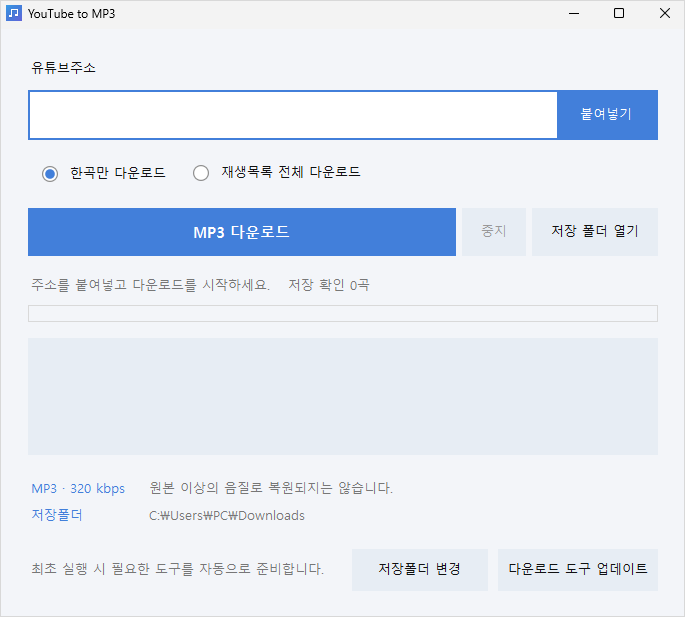

# YouTube to MP3

- [설치 EXE 다운로드](https://github.com/goyofunk/YouTubetoMP3/releases/latest/download/YouTube-to-MP3-1.0.0-Setup.exe) · Windows 64비트 · Python 별도 설치 불필요
- 설치 후 시작 메뉴에서 실행 → 유튜브 주소 입력 → MP3 다운로드
- 한 곡 또는 재생목록 전체 다운로드
- MP3 320kbps 변환 · 원본 이상의 음질로 복원되지는 않음
- 썸네일 표지와 제공되는 제목·음악가·앨범 태그 저장
- 기본 저장 위치: 내 계정의 Downloads 폴더 · 변경 가능
- 광고·결제·하루 다운로드 제한 없음 · 인터넷 연결 필요
- 다운로드 오류 시 프로그램에서 **다운로드 도구 업데이트** 실행
- [개발자 안내](docs/BUILD.md) · 오픈소스 고지는 설치 폴더에 포함
- 개인 학습·교육·연구용 도구이며, 저작물 사용에 따른 책임은 사용자에게 있습니다.
